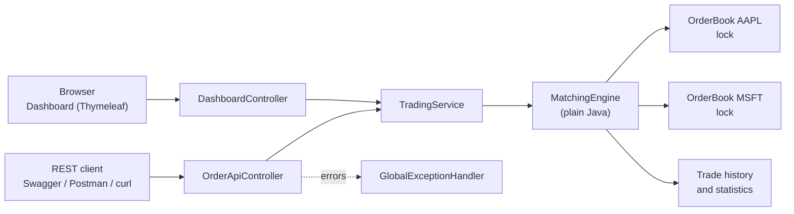

<div align="center">

# 📈 Spring Boot Trading Simulator

**A multithreaded order-matching engine with a REST API and a live web dashboard**


</div>

<!-- After running the app, take a screenshot of the dashboard, save it as docs/screenshot.png and uncomment the next line:

-->

## Overview

Trading Simulator models how a stock exchange matches buyers and sellers. Users place **limit orders** (buy or sell a symbol at a price and quantity). The engine matches them using **price-time priority**, supports **partial fills**, and records every **trade**. Orders can be placed from a browser dashboard or through a documented REST API.

The core is a small, dependency-free Java engine that is safe to use from many threads at once, wrapped in a layered Spring Boot application.

## Features

- **Price-time priority matching**: the best price wins, and the earliest order wins at equal prices
- **Partial fills and multi-level sweeps**: one large order can trade against several resting orders
- **Multiple symbols**: every symbol has its own independent order book
- **Order cancellation** for open and partially filled orders
- **Thread-safe by design**: one lock per order book, so different symbols match in parallel
- **REST API** with validation, consistent JSON errors and **Swagger UI**
- **Web dashboard** with live order books, open orders, recent trades and market statistics
- **Tested**: unit tests for every matching rule, a multi-threaded stress test, and API integration tests
- **Docker** image and **GitHub Actions** CI pipeline

## How Matching Works

| Rule | Behaviour |
|------|-----------|
| A BUY crosses a SELL when | buy price ≥ sell price |
| Which resting order is matched first | best price first (lowest ask, highest bid), then earliest arrival |
| Execution price | the price of the **resting** order (the one already in the book) |
| Quantity | `min(incoming remaining, resting remaining)`; the larger order keeps its remainder |
| Unmatched remainder | rests in the book until it is matched or cancelled |

**Example** (symbol `AAPL`)

| Step | Order | Result |
|------|-------|--------|
| 1 | Bindu: SELL 10 @ 101.50 | Rests in the book |
| 2 | Ravi: SELL 25 @ 102.00 | Rests in the book |
| 3 | Indu: BUY 20 @ 102.00 | Trade 1: 10 @ **101.50** with Bindu. Trade 2: 10 @ **102.00** with Ravi. Indu is `FILLED`. Ravi keeps 15 and becomes `PARTIALLY_FILLED` |

## Architecture



### Concurrency model

- Every symbol has its own `OrderBook` guarded by a `ReentrantLock`. Matching an order takes that lock, so an order is matched **atomically** and two threads can never consume the same resting quantity.
- Orders for different symbols use different locks and run **in parallel**.
- Arrival order (time priority) is assigned **inside** the lock, so it is exactly the order in which the book processed the orders.
- Order fill state is `volatile`, so the dashboard can read it safely while the engine is writing.
- A stress test submits 16,000 random orders from 8 threads and checks that bought quantity equals sold quantity, no order is over-filled, and the book is never left crossed.

> The first version of this project used a `CopyOnWriteArrayList` and a check-then-act loop in the controller. That is not atomic, because two requests could match the same order. This version fixes it with the per-book lock.

## Getting Started

**Requirements:** JDK 17+ and Maven 3.9+ (or Docker)

```bash
git clone https://github.com/SindhujaReddy-BIS/Spring-Boot-Trading-Simulator.git
cd Spring-Boot-Trading-Simulator
mvn spring-boot:run
```

| URL | What |
|-----|------|
| http://localhost:8080 | Web dashboard |
| http://localhost:8080/swagger-ui.html | Interactive API documentation |
| http://localhost:8080/actuator/health | Health check |

The app starts with a few sample orders. To start with an empty market, set `trading.demo-data=false` in `application.properties`.

### With Docker

```bash
docker build -t trading-simulator .
docker run -p 8080:8080 trading-simulator
```

## REST API

| Method | Endpoint | Description |
|--------|----------|-------------|
| `POST` | `/api/orders` | Place a limit order (returns `201` with the order and any trades) |
| `GET` | `/api/orders` | List orders. Filters: `symbol`, `user`, `status` |
| `GET` | `/api/orders/{id}` | Get one order |
| `DELETE` | `/api/orders/{id}` | Cancel an open order |
| `GET` | `/api/trades` | Recent trades, newest first. Params: `symbol`, `limit` (default 50, max 500) |
| `GET` | `/api/orderbook/{symbol}` | Aggregated bid and ask price levels |
| `GET` | `/api/symbols` | Symbols that have orders |
| `GET` | `/api/stats` | Order and trade totals, traded value, last price per symbol |

**Place an order**

```bash
curl -X POST http://localhost:8080/api/orders \
  -H "Content-Type: application/json" \
  -d '{"type":"BUY","user":"indu","symbol":"AAPL","price":102.00,"quantity":20}'
```

```json
{
  "order": {
    "id": 7, "type": "BUY", "user": "indu", "symbol": "AAPL", "price": 102.00,
    "quantity": 20, "filledQuantity": 20, "remainingQuantity": 0, "status": "FILLED"
  },
  "trades": [
    { "id": 1, "symbol": "AAPL", "price": 101.50, "quantity": 10, "buyer": "indu", "seller": "bindu" }
  ]
}
```

**Validation error** (`400 Bad Request`)

```json
{
  "status": 400,
  "error": "Bad Request",
  "message": "Validation failed",
  "details": { "price": "price must be at least 0.01", "quantity": "quantity must be at least 1" }
}
```

| Status | Meaning |
|--------|---------|
| `201` | Order accepted |
| `400` | Invalid input |
| `404` | Order not found |
| `409` | Order can no longer be cancelled (already filled or cancelled) |

On Windows Command Prompt, use Swagger UI or Postman instead of `curl`, because the JSON quoting is awkward there.

## Testing

```bash
mvn test
```

| Test class | Covers |
|------------|--------|
| `MatchingEngineTest` | Price and time priority, partial fills, multi-level sweeps, execution price, cancellation, validation, statistics, and a multi-threaded consistency test |
| `OrderApiIntegrationTest` | The REST API end to end: placing, matching, cancelling, validation errors, `404` and `409` responses, order book, dashboard page |
| `TradingSimulatorApplicationTests` | The Spring context starts |

Tests run automatically on every push through GitHub Actions (`.github/workflows/ci.yml`).

## Project Structure

```
src/main/java/com/trading/simulator
├── TradingSimulatorApplication.java
├── engine                  # Core logic: plain Java, no Spring
│   ├── MatchingEngine.java     # entry point: submit, cancel, queries, statistics
│   ├── OrderBook.java          # one symbol: priority queues, lock, matching loop
│   ├── Order.java, Trade.java, PriceLevel.java, BookSnapshot.java, ...
├── service/TradingService.java # application layer: logging and DTO mapping
├── controller
│   ├── OrderApiController.java # REST API
│   └── DashboardController.java# web dashboard
├── dto                     # OrderRequest (validated), OrderResponse, SubmitResponse
├── exception               # GlobalExceptionHandler, ApiError
└── config                  # engine bean, OpenAPI info, optional demo data
src/main/resources/templates/index.html   # Thymeleaf + Bootstrap dashboard
```

## Design Decisions

- **The engine has no Spring dependency**, so it can be unit-tested directly and reused anywhere.
- **Prices use `BigDecimal`** with exactly 2 decimals, so there are no floating-point errors.
- **Nothing is persisted.** The market lives in memory and resets on restart. This keeps the focus on matching and concurrency. Completed trade history is capped at the latest 10,000 trades.
- **Validation happens twice**: Bean Validation at the API boundary (clear messages) and again in the engine (so the engine is safe on its own).

## Roadmap

- [ ] Persist orders and trades with Spring Data JPA and PostgreSQL
- [ ] Live dashboard updates over WebSocket
- [ ] Market orders and time-in-force options (IOC, FOK)
- [ ] Self-trade prevention
- [ ] Authentication and per-user portfolios
- [ ] Metrics with Micrometer and Prometheus

## Author

**Sindhuja Reddy**: [GitHub](https://github.com/SindhujaReddy-BIS)

Licensed under the [MIT License](LICENSE).
